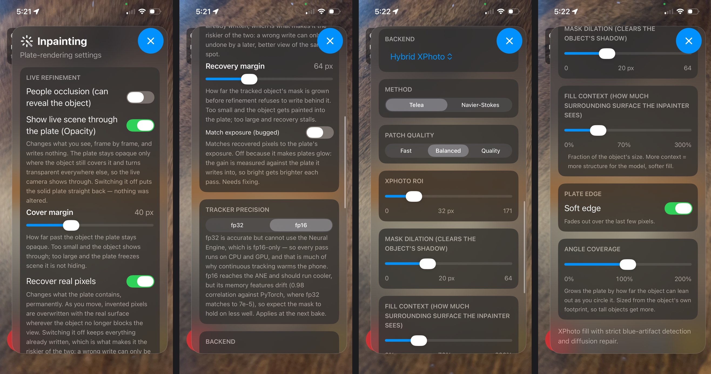
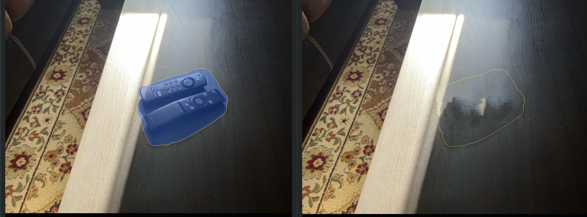
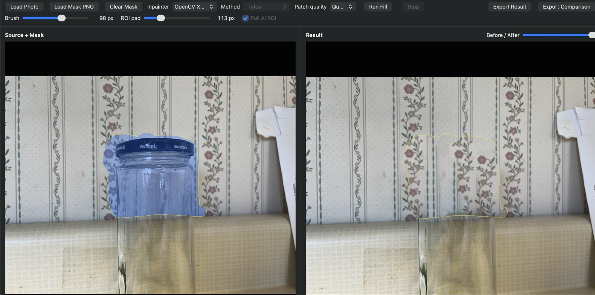

# Diminished Reality (DR) on iPhone without LiDAR

An iPhone app that makes a real object disappear from the live camera view. Tap an object and the app removes it, fills in what was behind it, and keeps it gone as you walk around.

It runs fully offline on an iPhone 13, which has no LiDAR depth sensor, so every bit of 3D information comes from a single camera.

*Documentation only, no source published. I led the design, testing, model selection and licensing decisions; the Swift code was written by AI coding agents.*

https://github.com/user-attachments/assets/a5e7e125-cd4e-4315-b66f-5e458a34e8f9

*A vase removed from a corner where the wall meets the floor, at 3x speed. The plate is split across both surfaces and real pixels are recovered as the camera moves. The iPhone heated up quicker and slowed down in this demo because of the screen recording.*

---

## Constraints

- **Offline.** No server, runs purely on an iPhones processor.
- **iPhone 13, no LiDAR.** Depth and surfaces have to be estimated from the camera and motion sensors alone.
- **4 GB of RAM.** iOS kills the app at about 2.1 GB, and AI models are the largest share of the app's memory.
- **60 fps preview**, no matter what else is running.
- **No prior scanning.** The app has no idea what exactly is behind an object, and must try its best to guess what backgrounds look like.
- **Under 3 s of delay** from tap to removal (met with the shippable fill methods and when the phone isn’t hot).
- **Commercially usable.** Every model and algorithm had to be legal to ship in a paid product, without licensing deals.

---

## Objectives
- **Design for as many objects as possible** to be removed. Bottles, boxes, furniture, cars.
- **Design for as many scenes as possible** such as a tall bottle on a coffee table, a large couch in a living room, or construction pylons on a road.
- **Keep processing time minimal** to keep the user engaged without sacrificing quality to the point that removals no longer look convincing.
---

## Prior work, and why I built my own

I found no app that removes any object the user picks from a live camera feed on a phone without LiDAR. What exists is outdated research implementations, commercial products that handle one kind of object, or photo editors.

| Prior work | What it does | Why I didn't build on it |
| --- | --- | --- |
| [PixMix, Herling & Broll (2010–2012)](https://ieeexplore.ieee.org/abstract/document/6402551) | Real-time object removal with no pre-scan of the room. Re-fills every frame at 17–25 fps (640×480) on a laptop CPU, not a phone | Assumes an almost flat background, and the authors say it can't handle background revealed by walking around a 3D object. No official published code. Its patents lapsed but didn't expire. |
| [ProPainter (ICCV 2023)](https://github.com/sczhou/ProPainter) | Removes a masked object from recorded video while keeping frames consistent | Works on recorded clips, not a live feed, and is heavy to run. Licensed for non-commercial use only. |
| ViewAR SDK | Removes an object covering one flat surface such as a wall, so a product can be placed there | Commercial business tool for one object type on a flat wall |
| IKEA Kreativ | Erases furniture from a photo of a room | Still photos, not a live feed |

**Why from scratch:**

1. **Nothing fits the goal.** The open DR code is desktop research code, and each commercial product handles one object type.
2. **ARKit changes the design.** ARKit tracks the phone's position and detects surfaces every frame, which was the hardest problem in older systems. A design built on that is different enough that adapting older code would have meant rewriting most of it.
3. **Licensing.** Every component also had to be commercially usable, which rules out most existing code and model weights (see [Licensing and patents](#licensing-and-patents)).

---

## How it works

1. **Tap:** the app outlines the object you tapped (segmentation).
2. **Fill:** it paints in the background hidden behind the object (inpainting).
3. **Pin:** it places that fill, called the *plate*, on the floor or table in 3D, so it stays in place as the camera moves. If the object covers more than one surface, like a corner where a wall meets the floor, the plate is split across every surface it covers.
4. **Track:** every frame, it follows the object so it never shows through its own fill, and swaps in real pixels as the camera sees more of the hidden area.

The slow steps (segmentation and inpainting) run once at the tap, where a short wait is fine. The per-frame work is kept light to maintain 60 fps.

**Segmentation models:** Apple Vision picks and outlines the tapped object, then EdgeTAM (a lightweight model that keeps tracking the same object frame to frame) follows it at 2 Hz. Vision alone returned nothing on half of attempts and couldn’t remember which object you picked.

---

## In-app settings

Every major behaviour can be switched or tuned live on the phone, which made on-device testing much faster than rebuilding the app for each change. The most important ones:

| Setting | What it does |
| --- | --- |
| **Show live scene through the plate** | Makes only part of the plate solid where the object's silhouette still covers it, and transparent everywhere else, so the live camera shows through. |
| **Recover real pixels** | As you move, invented pixels in the plate are permanently replaced with the real surface wherever the object no longer blocks the view. |
| **Tracker precision (fp32 / fp16)** | fp32 is more accurate but can't use the Neural Engine. fp16 runs on the Neural Engine and runs cooler, at a small cost in accuracy (see [Benchmarks](#benchmarks)). |
| **Inpainting backend** | Picks the fill method: Hybrid XPhoto, Criminisi, LaMa (test only), OpenCV Diffusion. Hybrid XPhoto uses OpenCV xphoto, detects leftover artifacts, and repairs them with a diffusion fill. |
| **Mask dilation** | Grows the object's outline by a few pixels so its shadow and edges are removed too. |
| **Angle coverage** | Grows the plate by how far the object can lean out as you circle it, so tall objects get a larger plate. |

---

## Keeping it cool and within memory

Phones slow themselves down when they heat up. Once the iPhone hit its "serious" thermal state, the preview dropped from 60 to 30 fps and AI processing became about 3× slower. I started logging the thermal state with every measurement, then switched features on and off one at a time to find the cause: the object tracker.

**The iPhone's Neural Engine only runs fp16.** The Apple Neural Engine (ANE), the iPhone's dedicated AI chip, only accepts 16-bit models. Any model kept at 32-bit runs on the CPU and GPU instead, which use more power and produce more heat. That one fact explains most of the thermal behaviour below.

Converting the EdgeTAM tracker model from 32-bit to 16-bit neural weights (fp32 to fp16) made each run 2.4× faster. Counting how many times it ran explained the rest: the tracker restarted as soon as it finished, so the faster model simply ran about 4× as often and spent the savings. Capping it at 2 runs per second, and skipping it when the camera hadn't moved, fixed that.

| Tracker | fp32 | fp16 |
| --- | --- | --- |
| Time per run | ~500 ms | ~208 ms |
| # of runs in a ~9.5 min test (uncapped) | ~180 | ~780 |
| Time until _serious_ thermal state | ~3.5 min | ~6 min |
| Peak memory | 931 MB | 677 MB |

**Pre-warming.** The first time an fp16 model loads, iOS compiles it for that device's specific Neural Engine, so this can't be done ahead of time on a Mac. That first load takes 13.6–17.0 s (6.0 s once cached), against 1.5–2.2 s for fp32. Loading it in the background at launch hides the wait in time the user already spends aiming the camera.

---

## Evaluation

### Choosing an inpainting method (offline)

Before putting anything on the phone, I made a desktop test tool and compared fill methods on real photos: a wood deck, wallpaper, a desk with paper documents, and a group of plant pots. The goal was to generate an infill plausible enough that it was not distracting to the user.

| Method | Result | Decision |
| --- | --- | --- |
| Telea / Navier–Stokes (Diffusion) | Blurry smear on large holes | Rejected |
| **Criminisi** | Good on smooth, textureless surfaces | Shippable |
| **OpenCV xphoto (shift-map)** | Best on surfaces covered with a pattern like wallpaper | Shippable |
| LaMa (AI) | Best quality | Benchmark only, weights not cleared for commercial use |
| MI-GAN (AI) | Poor, distracting fills | Rejected |
| PatchMatch | Good but slow | Rejected, patented until ~2029 |

*Criminisi test: two TV remotes masked (left) and removed (right). The table fills well, but the fill breaks into distinct blocks where the patch of sunlight crosses the hole.*

*OpenCV xphoto in my test tool: a jar masked against patterned wallpaper (left) and removed (right). The repeating floral pattern is rebuilt, with a faint seam where the stripes meet.*

Two lessons from these tests: **dilate the mask** to engulf small details like printed text on paper, and **cut out neighbouring objects' masks** so the fill doesn't copy or erase them.

### On device

*A water bottle removed from a floor. Green: area filled in with diffusion-based inpainting. Red: area restored from real camera pixels seen earlier.*

**Working:**
- Simple objects (cups, bottles, boxes)
- Odd shapes. Headphones and a pump bottle flickered because the 3D shape model assumed simple convex blobs. Replaced with a height-map model.
- Objects covering several surfaces at once, such as a wall corner and the floor (tested with up to 17 detected surfaces in a scene and an object spanning 3).
- Recovering after the phone overheated.

**Broken, and why:**
- **People walking in front of removed objects**. ARKit's `.personSegmentation` sometimes falsely recognizes humans, causing part of the object to reveal through its own fill. Now off by default. 
- **Missed surfaces.** If the phone never detected the table, an object on it was removed as if it sat on the floor. I first tried to fix how surfaces were chosen, before realizing the right surface was never detected at all. This is why I'm adding a depth model: Depth Anything V2 Small.
- **Changing light.** The brightness correction function fed back on itself and made the fill glow. It's turned off for now.

---

## Limitations
- **Inpainting time is unpredictable.** Criminisi and xphoto (shift-map) take
  2–5 s per removal, depending on the image and the size of the hole. Both run
  only on the CPU, which adds to the device's thermal load. Moving one of them onto the GPU
  would reduce compute time and let the phone stay cooler longer.
- **Plane detection without LiDAR misses surfaces.** On the iPhone 13, ARKit
  traces floors accurately but often misses walls narrower than about 1 m and
  dark surfaces in bright rooms. When it misses the surface an object rests on,
  the removal lands on the wrong plane (see [On device](#on-device)). An iPhone 16 Pro
  Max, which has LiDAR, detected wall cabinets, couches, doors and curtains in
  the same rooms. A monocular depth model such as Depth Anything V2, which estimates distances from a
  single image, is my plan to close part of that gap, but not yet tested.

---

## Licensing and patents

Shipping commercially meant I needed to conduct a patent check and read source code licenses:

- **Model weights have their own licence.** 
    - LaMa's code is open, but its weights were trained on the Places2 image dataset which is non-commercial use only.
    - Depth Anything V2 allows commercial use in its small version but not its large one.
- **Algorithms can be patented.** I checked each method on Google Patents. The patents on Criminisi and shift-map have lapsed; the xphoto version's application was never granted. PatchMatch is patented until about 2029, so I didn't use it.

---

## Road map
- Adding a depth model for better surface detection (see [On device](#on-device) Evaluation).
- Testing multiple diminished objects. Seeing how many objects can disappear at once while checking RAM and thermal state.
- Implementing iOS 27's [new image segmentation model](https://developer.apple.com/videos/play/wwdc2026/237/).
- Full scene reconstruction for 3D-aware infills.
- Person and object occlusion.

---

## Why not train my own AI model for inpainting?

LaMa was the best inpainter during testing: it filled large holes and kept straight
edges intact. Its code is free for commercial use, but the trained model was
built from photos its authors don't hold the rights to
([Licensing and patents](#licensing-and-patents)).

Retraining it on a licensed image dataset, such as Google's Open Images (about 9 million
photos listed under a commercial-use Creative Commons licence), is possible but
expensive. Big LaMa has 51 million parameters and took 1,920 GPU-hours to train on 4.5 million images, and 
one mistake found late during training
can mean starting over. A smaller model would be cheaper, but MI-GAN, a
lightweight inpainter built for phones, gave poor fills in every test and still has
the same licensing problem.

---

## What I learned

- **Search prior art** to find out what methods currently work, what code, algorithms or SDKs are already published, or what did not work in the past but can finally be tested with today's advances.
- **Plan and prototype together, then optimize** to discover what's possible on the current most popular phones and develop your roadmap around that. This helps avoid technology barriers later.
- **Test the harder cases from the start.** One odd-shaped object invalidated a whole approach.
- **Build natively for the target device.** Porting ML models to CoreML instead of ONNX and using fp16 weights let them run on ANE. Measuring with released builds, not debug builds, gives realistic timings.
- **Take the lead when developing with agents.** Agentic coding let me build something much larger than I could have alone. By prompting it to teach the concepts that are new to me in this project, I had a clearer view of where to steer it. My main job was setting the goals, testing on device, and deciding what to keep.
- **Check for licenses and patents**: model weights have their own separate licenses from the code, and software algorithms can be patented. Do a basic freedom-to-operate check.

---

## Benchmarks

iPhone 13 (A15 chip, 4 GB RAM, no LiDAR), release builds.

### Phone

| Metric | Value |
| --- | --- |
| Memory limit before iOS kills the app | ~2.1 GB |
| Memory at idle | 155–272 MB |
| Memory after one removal | 866 MB, settling to ~640 MB |
| Frame rate, normal | 60 fps |
| Frame rate, _serious_ thermal state | 30 fps |
| Recovery from _serious_ | ~10 s to drop a level, ~1 min to full frame rate |

### Tracker (EdgeTAM), fp32 vs fp16

| Stage | fp32 | fp16 |
| --- | --- | --- |
| Image encoding | ~175 ms | ~38 ms |
| Memory attention | ~240 ms | ~90 ms |
| Mask decoding | ~50 ms | ~45 ms |
| Memory write | ~35 ms | ~35 ms |
| **Total per run** | **~500 ms** | **~208 ms** |
| Model size on disk | 76 MB | 40 MB |
| First load | 1.5–2.2 s | 13.6–17.0 s |
| Cached load | – | 6.0 s |
| Match to original PyTorch model | ~7e-5 error | 0.98 correlation |

### Inpainting

| Method | Resolution | Time (cool) | Time (hot / throttled) |
| --- | --- | --- | --- |
| Criminisi | 512 px | 1–5 s | – |
| OpenCV xphoto (shift-map) | 512 px | 1–5 s | – |
| LaMa (reference only) | 512 px | 2.97 s | 7.24 s |
| LaMa (reference only) | 800 px | 8.56 s | 24.6–29.9 s |

LaMa at 800 px peaks at 1.2–1.4 GB of memory, which triggers iOS memory warnings mid-run, so it's limited to phones with more than 4 GB.

### One removal, step by step

| Step | Time |
| --- | --- |
| Frame conversion | 4–32 ms |
| Object segmentation (Vision) | 127–343 ms |
| Finding the surface | 3–10 ms |
| Full removal at 512 px (LaMa) | 3.5–7.6 s |
| Compositing and drawing | 82–344 ms |

---

## Built with

Swift · ARKit · Core ML · Apple Vision · EdgeTAM · OpenCV · iPhone 13 (A15, 4 GB)
